# Twinkle Toes system flow

```mermaid
flowchart TD
    Start["Start server (npm start)"] --> Env["Load .env settings and provider keys"]
    Env --> Web["Serve display and controller over HTTP or configured HTTPS"]
    Web --> Clients["Browser connects to /api/events (SSE) and checks /api/status"]
    Clients --> Settings["Optional provider keys saved in this browser"]
    Clients --> Choice{"How does the person talk?"}

    subgraph Input["Input"]
        Voice["Display microphone captures audio"]
        Transcribe["POST /api/transcribe"]
        Whisper["Groq Whisper transcribes audio to text and detects language"]
        Caption["Show 'I heard: …' on the display"]
        Typed["Controller submits typed message"]
        ChatRequest["POST /api/chat"]
        Voice --> Transcribe --> Whisper --> Caption --> ChatRequest
        Typed --> ChatRequest
    end
    Settings --> Choice
    Choice --> Voice
    Choice --> Typed

    subgraph Reasoning["Conversation and model"]
        Validate["Validate message and mark bot as thinking"]
        Context["Detect language and add persona plus recent conversation"]
        Model["Selected supported chat provider and its configured model"]
        Tools{"Needs an approved app link or web search?"}
        AppTool["Prepare allowlisted action button"]
        SearchTool["Run optional Tavily web search"]
        Followup["Model composes answer using tool result"]
        Check["Check reply language and mood; correct language if needed"]
        Save["Remember this turn in short-term memory"]
        Validate --> Context --> Model
        Model --> Tools
        Tools -- App link --> AppTool --> Followup
        Tools -- Web search --> SearchTool --> Followup
        Tools -- Neither --> Check
        Followup --> Check
        Check --> Save
    end
    ChatRequest --> Validate

    subgraph Output["Reply and speech"]
        Event["Publish reply and expression using SSE"]
        Display["Display updates animated eyes and caption"]
        SpeechRequest["Display requests POST /api/speech"]
        LanguageVoice{"Reply language?"}
        FishTTS["Fish Audio (primary when configured)"]
        NvidiaTTS["NVIDIA Riva Chatterbox (only if Fish Audio is not configured)"]
        Piper["Local Piper fallback (English only)"]
        Audio["Return generated audio to browser"]
        Play["Browser plays audio"]
        Event --> Display --> SpeechRequest --> LanguageVoice
        LanguageVoice --> FishTTS
        FishTTS -- Not configured --> NvidiaTTS
        FishTTS -- English failure --> Piper
        FishTTS -- Hindi failure --> Error["Show speech error"]
        NvidiaTTS -- Success --> Audio
        NvidiaTTS -- English failure --> Piper
        NvidiaTTS -- Hindi failure --> Error
        NvidiaTTS -- Not configured --> Piper
        FishTTS -- Success --> Audio
        Piper --> Audio --> Play
    end
    Save --> Event

    Interrupt["Tap bottom microphone while speaking"] --> StopAudio["Stop current browser playback"]
    StopAudio --> Voice
    Activity["Touch or key press resets resting timer"] --> IdleState["After 30 seconds: idle eyes; after 2 minutes: sleepy eyes"]
    IdleState -- New activity --> Activity
    Save --> ActionButton["Show approved HTTPS action button"]
    ActionButton --> UserTap{"Person taps Open?"}
    UserTap -- Yes --> AppLink["Android may open the linked app or browser"]
    UserTap -- Dismiss --> Choice
    Play --> Interrupt
    Play --> Choice
```

## What the flow means

- The chat model receives **text**, not raw microphone audio. For voice input, Groq Whisper converts the recording to text first; the display shows the recognized words so they can be checked.
- Typed controller messages skip speech recognition and enter the same chat pipeline.
- The server adds Twinkle Toes' persona, language rules, and recent conversation before calling the selected chat model. Tavily search is optional and used when enabled and needed.
- The display gets the reply and eye expression over server-sent events (SSE). It then requests synthesized audio separately and plays it in the browser.
- Voice synthesis uses Fish Audio first when configured. NVIDIA Chatterbox is used only if Fish Audio is not configured; local Piper is the English-only fallback. Hindi needs a configured online Hindi voice.
- The bottom microphone interrupts **audio playback** and starts listening again. It does not cancel a chat-model request already running on the server.
- When the display is inactive, it returns to idle eyes after 30 seconds and sleepy eyes after two minutes. Touch or key input wakes it; listening and replies suspend the timer.
- App links are restricted to YouTube, Spotify, Gmail, and Google search. A person must tap the action button; Android decides whether an installed app or the browser handles the link. This website does not launch Windows applications or request blanket app-launch permission.
- Replies and audio are delivered after each request completes; this is not token-by-token or live speech streaming.
- Browser-entered provider keys stay in that browser's local storage and are sent with only the requests that use them. Server `.env` keys remain the defaults.
- Browser-entered keys are not encrypted in local storage; use HTTPS on shared networks and do not expose this unauthenticated self-hosted server as a public multi-user site.
